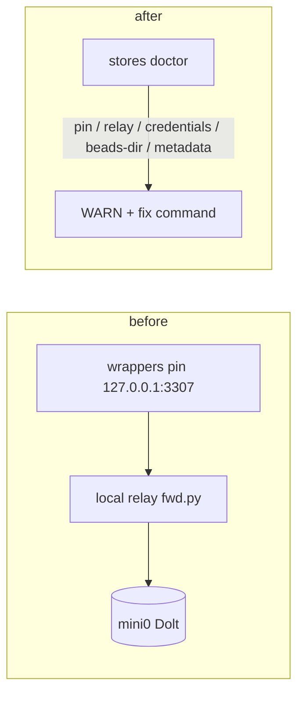

# Doctor output on a mini1-style host (sample, from the real classifier)



```text
== store-host.env = 127.0.0.1:3307 (relay)
WARN host pin  ~/.local/bin/brain
     wrapper sets the store host 127.0.0.1 unconditionally instead of reading store-host.env (it agrees today, repointing would leave it behind): export BEADS_DOLT_SERVER_HOST=127.0.0.1
     fix: brain stores rewrite-wrappers on mini1 (or doctor --fleet --repair)
WARN host pin  ~/.local/bin/brain
     wrapper sets the store host ?:3307 unconditionally instead of reading store-host.env (it agrees today, repointing would leave it behind): export BEADS_DOLT_SERVER_PORT=3307
     fix: brain stores rewrite-wrappers on mini1 (or doctor --fleet --repair)
WARN host relay  ~/.config/brain/store-host.env
     store-host.env names 127.0.0.1:3307 but no Dolt server runs on mini1: this machine reaches the store through a local relay/forwarder and stops working when it does
     fix: point store-host.env at the machine that runs Dolt (doctor never edits it), add a [host:port] entry for it to the credentials file, run 'brain stores rewrite-wrappers', then stop the relay; if a forwarder is intended, declare store_host: 127.0.0.1:3307 for mini1 in fleet.yaml
WARN host wrapper-beads-dir  ~/.pi/agent/bin/status
     wrapper's BEADS_DIR does not exist on this machine: /Users/gone/status/.beads
     fix: remove ~/.pi/agent/bin/status, or restore the store directory /Users/gone/status/.beads
== store-host.env = 100.84.99.99:3307 (mini0), no credential entry
WARN host pin  ~/.local/bin/brain
     wrapper pins 127.0.0.1 but the host should be 100.84.99.99:3307: export BEADS_DOLT_SERVER_HOST=127.0.0.1
     fix: brain stores rewrite-wrappers on mini1 (or doctor --fleet --repair)
WARN host pin  ~/.local/bin/brain
     wrapper sets the store host ?:3307 unconditionally instead of reading store-host.env (it agrees today, repointing would leave it behind): export BEADS_DOLT_SERVER_PORT=3307
     fix: brain stores rewrite-wrappers on mini1 (or doctor --fleet --repair)
WARN host wrapper-beads-dir  ~/.pi/agent/bin/status
     wrapper's BEADS_DIR does not exist on this machine: /Users/gone/status/.beads
     fix: remove ~/.pi/agent/bin/status, or restore the store directory /Users/gone/status/.beads
WARN host credentials  ~/credentials
     no credential entry for 100.84.99.99:3307, the server store-host.env names (it only has [127.0.0.1:3307])
     fix: add a [100.84.99.99:3307] section with password=... to ~/credentials (doctor never writes credentials); skip if that server takes no password
```
