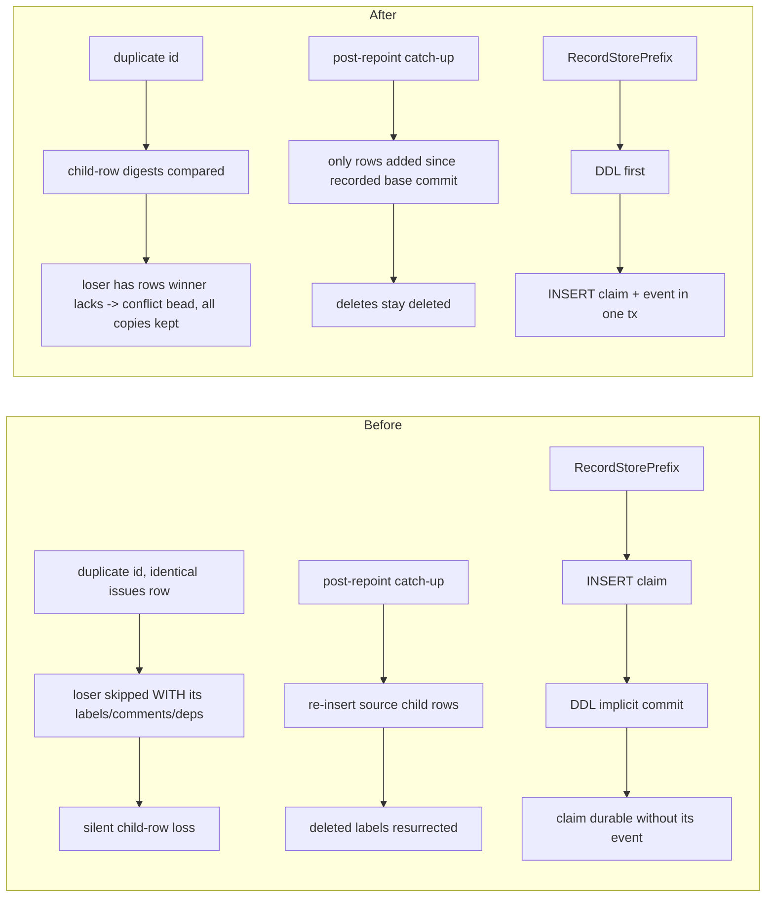

# task-fburn26: unify/prefix cutover blockers

Fixed: D-F1, D-F1b, C-F1, C-F2, F-F1. Tests: `go test ./internal/brainunify/ ./internal/storage/issueops/` pass.
Deferred (own beads): C-F3, F-F2/F-F3.
