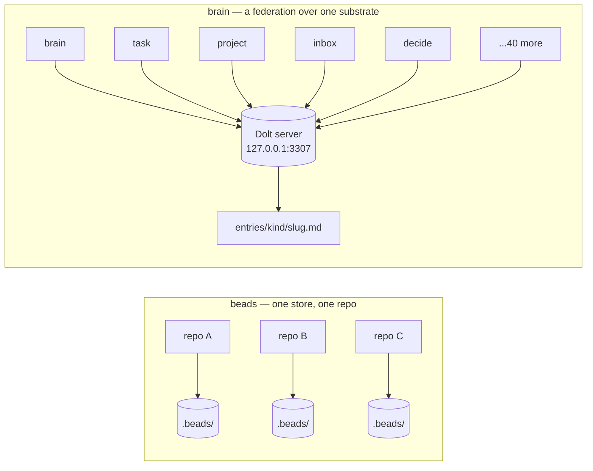
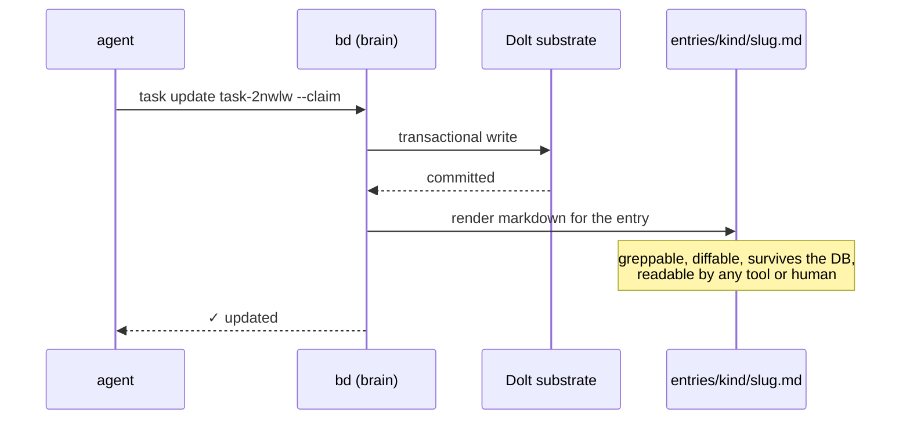
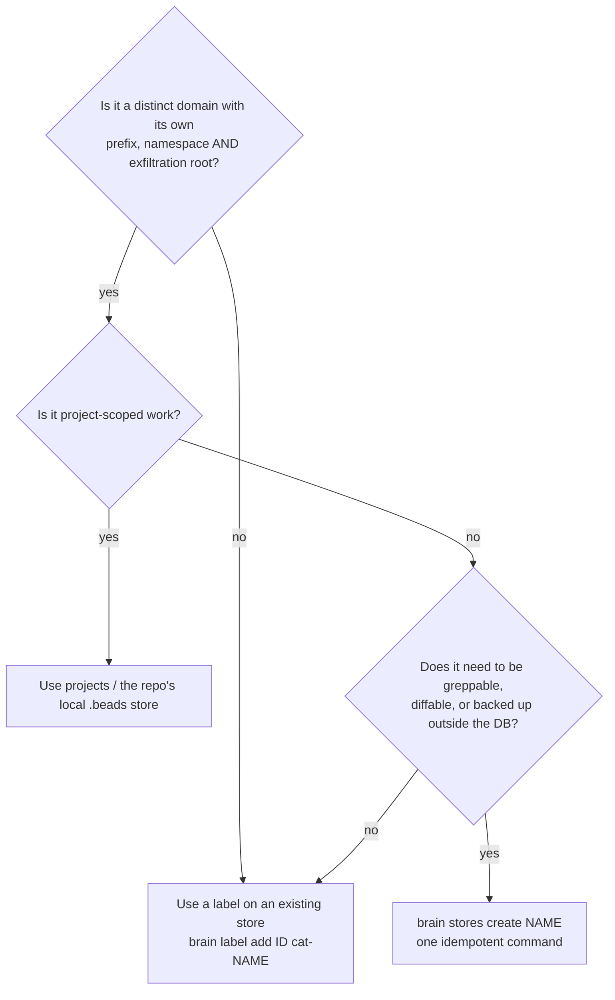

# brain vs beads: one store, or a federation?

> **Thesis.** beads is a versioned issue tracker. brain is what you get when you
> notice that an agent's *knowledge*, its *tasks*, and its *decisions* are the
> same shape — and that an agent which cannot read its own memory with `grep`
> does not really have memory. brain keeps beads' substrate and changes the
> *scope*: from one store per repo to a family of stores per life, each with its
> own name, its own boundary, and a markdown copy on disk.

This document exists because the difference is easy to feel and hard to state.
It is written for someone deciding whether the fork earns its maintenance cost.

---

## 1. The same substrate, a different question

beads answers: *"what is the state of the work in this repo?"*
brain answers: *"what do I know, what am I doing, and what did I decide — across
everything?"*

Both are Go binaries over a versioned Dolt substrate with a graph-shaped issue
model. brain is a **fork of [beads](https://github.com/gastownhall/beads)**
(`README.md`: *"It keeps beads' versioned Dolt substrate and graph-shaped issue
model"*). Nothing about the substrate is reinvented. What changes is the unit of
ownership:

In beads, the store boundary is *the repository*. In brain, the store boundary is
*the domain* — knowledge, tasks, projects, people, decisions, ideas, assertions —
and the repository keeps its own local store for work that belongs with the code.

---

## 2. What the fork actually adds

Straight from `README.md` § *What brain adds to beads*, with the mechanism named:

| Capability | beads | brain | Why it exists |
|---|---|---|---|
| **Store scope** | one store per repo | a federation: ~40 stores, one Dolt DB each | knowledge, tasks and decisions have different lifetimes and different audiences |
| **Addressing** | local ids | **self-describing prefixes** (`task-`, `brain-`, `person-`) | an id pasted anywhere says which store owns it |
| **Discovery** | per-store `bd` | `brain stores list` — canonical registry (`~/.config/pai/stores.yaml`) | the registry drives *both* the binary and the shell wrappers |
| **Cross-store search** | — | `brain search X` fans out across every registered store | memory that needs to know where to look is not memory |
| **Provisioning** | manual `bd init` | `brain stores create <name>` — dolt init + entries dir + CLI wrapper + registry write + env regen, **idempotently** | a new domain should cost one command, not a checklist |
| **Markdown exfiltration** | DB only | **every mutation renders** `<store>/entries/<kind>/<slug>.md` | the substrate must be readable by tools that know nothing about beads |
| **Exfil root** | — | `BRAIN_KNOWLEDGE_ROOT` → `dirname($BEADS_DIR)/entries` → `~/data/brain/entries` | each store's markdown lands in *its own* tree — the boundary is physical, not just logical |
| **Re-render** | — | `bd render <id>`, `bd render-all` | recover the on-disk copy when it is missing, stale, or hand-edited |
| **Kind discriminator** | issues | `kind: task \| knowledge \| both \| isa` in one bag | tasks and knowledge are the same shape; one substrate beats two |
| **ISA primitives** | — | `brain new isa`, `brain isa-section` (PAI Algorithm v6.4+) | an ISA is a durable artifact, not a chat message |
| **Feature intake** | — | an unknown flag on a `brain` command auto-files a feature request | friction in reporting is friction in fixing |
| **Versioning** | single semver | **double semver**: `<beadsVersion>+brain.<brainVersion>` | the fork must state which upstream it was rebased on |

### 2.1 The exfiltration feature is the load-bearing one

It is the least obvious and the most consequential. A database is only usable by
the tools that speak to it. An agent that wants to `grep` its own memory, a
human who wants to read it in an editor, a backup that must survive the DB, a
diff in git — none of those can talk to Dolt. So brain treats the markdown as a
**first-class output**, not an export:

`bd render`/`render-all` close the loop: if the markdown is lost or drifts, it
can be regenerated from the substrate, so the two representations cannot
silently diverge forever.

---

## 3. Why a federation, rather than one big store

### 3.1 Because a boundary you can enforce is worth more than a tag you can forget

A single store with a `category` field is cheaper to build and cheaper to
mistake. But **exfiltration is a security property**, and security properties
need edges. brain's own doctrine (`~/data/README.md`): a new store is warranted
when a domain is *"distinct enough to own its own prefix, namespace, and
exfiltration root"* — and, critically, the same document says **not** to create
a store for a new *category of knowledge* (use a label), nor for a
project-scoped tracker (use `projects`). The federation is deliberately
expensive to extend, so that extending it means something.

The physical consequence is what makes it real: because each store renders into
`<store>/entries/`, "this content must never leave the machine" is a directory
permission rather than an audit of a shared table.

### 3.2 Because different domains have different clocks

| Domain | Store | Clock | Who reads it |
|---|---|---|---|
| Capture | `inbox` | seconds — must be frictionless | you, later |
| Work | `task`, `projects` | days | agents and you |
| Knowledge | `brain` | months to forever | agents, docs, future you |
| Decisions | `decisions` | forever, with rationale | whoever asks "why is it like this?" |
| Enforcement | `robots`, `violations` | forever, evidence-bearing | the guard system |

One store would force one retention and one access policy on all five.

### 3.3 Because capture must be free

`inbox` exists so that capture has **zero classification overhead** — the
README's *"capture first, classify later"*. Every classification decision you
force at capture time is a reason not to capture. The federation makes the cheap
action available first and the expensive action deferred.

---

## 4. What it costs (the honest column)

A persuasive document that omits this is an advertisement, and this fork's own
history argues against writing one:

| Cost | Evidence |
|---|---|
| **Rebase maintenance.** The fork tracks an upstream that moves. | Double semver exists precisely to keep the base visible: `1.1.0-rc.1+brain.0.4.0`. |
| **Two release lines can diverge.** A fork's `main` and the *installed* binary are not automatically the same code. | Measured 2026-09-27: the installed `bd` is `1.2.2+brain.` while building this repo's `origin/main` yields `1.1.0-rc.1+brain.0.0.0-dev` — different lines. Installing the newer-looking build would have **downgraded** the fleet, so it was deliberately not deployed. |
| **Accidental releases happen, and recovery is a document.** | `CHANGELOG.md` v1.2.2: v1.2.0/v1.2.1 shipped without release testing, forcing a recovery release and a `schema version mismatch` fix (`docs/RECOVERY-1.2.1.md`). |
| **Documentation drifts from the registry.** | This repo's `README.md` still lists the knowledge store at `~/data/knowledge/.beads/`; the live registry (`~/.config/pai/stores.yaml`, `~/data/README.md`) says it was renamed to `brain/` on 2026-06-25. |

None of these are arguments against the fork. They are arguments for **treating
the registry as canonical and the README as prose** — which is why `brain stores
list` is the authority and this document cites it.

---

## 5. Decision rule

**The one-sentence version.** beads gives you a store per repository; brain gives
you a store per *domain*, a registry that makes the family addressable, and a
markdown mirror that keeps every store readable by tools that will never know
beads exists.

---

## Appendix — evidence

- `README.md` — *"brain is a Go fork of beads"*; § *What brain adds to beads*; § *The model* (store table); § *Store registry*; § *How it ships* (wrapper form); § *Versioning* (double semver).
- `~/data/README.md` — shared Dolt server on `127.0.0.1:3307`, one database per store; the purpose table; the "when is a new store warranted" rule and its two prohibitions.
- `~/.config/pai/stores.yaml` — the canonical registry (`brain stores list`).
- `CHANGELOG.md` v1.2.2 — the accidental-release recovery, `docs/RECOVERY-1.2.1.md`.
- `BRAIN_*` environment surface in the Go sources: `BRAIN_ISA_EXFIL_ROOT` (22), `BRAIN_KNOWLEDGE_ROOT` (11), `BRAIN_EXFIL_FLAT` (9), `BRAIN_NO_EXFIL` (4), `BRAIN_NO_AUTO_FEATURE_REQUEST` (3).
- Measured 2026-09-27: installed `bd` = `1.2.2+brain.`; this repo's `origin/main` build = `1.1.0-rc.1+brain.0.0.0-dev` (see the cost table).
