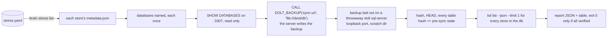

# Backing the federation up: `bd brain federation-backup`

The federation is one Dolt sql-server (mini0, port 3307) holding one database,
`brain_unified`, that every registered store lives in. On 2026-08-04 an
autonomous job copied the live server's data directory file by file, left
three sql-servers running, and broke every store at once (incident
`~/code/firstmate/data/incidents/2026-08-04-dolt-federation-outage.md`,
`robots-15qy`, `question-sje`). This verb is the backup that cannot do that:
it never reads the data directory, and it refuses a destination inside one.

```
bd brain federation-backup --dest /path/outside/every/data/dir
```

## What it does



1. **Iterate the registry.** The same file `brain stores list` prints
   (`~/.config/brain/stores.yaml`, or `--registry`). For each store the
   `.beads/metadata.json` is read for `dolt_database`,
   `global_dolt_database` and `dolt_server_port`. A store whose metadata
   cannot be read, or that names another server's port, is a failure of the
   run (its database is unknown, so the run cannot claim to cover it). Scope
   with `--store <name>` (repeatable).
2. **Plan the databases.** Every database the stores name, once. Today that
   is `brain_unified` (every store) plus `beads_global`, which some stores
   name as their global database but which the live server does not hold.
3. **Read the server once.** `SHOW DATABASES`. A named database that is not
   there is reported **absent** (a warning, not a failure: there is nothing to
   back up, and the metadata is the thing to fix). A database on the server
   that no store names is listed and skipped unless `--all-databases`.
4. **Back each database up server-side.** On a pinned connection the
   pre-sync state is read (`dolt_hashof_db`, `DOLT_HASHOF('HEAD')`, every
   table's `DOLT_HASHOF_TABLE`, the `issues` row count), then
   `CALL DOLT_BACKUP('sync-url', 'file://<dest>/<db>')`. The **server**
   writes the backup; this process never opens the data directory. The hash
   is read again afterwards so a write during the sync is known. A second run
   syncs into the same directory: `<dest>` holds one backup per database.
5. **Prove each backup.** The backup's chunk store is laid out as a database
   under `<dest>/.scratch/verify-<db>-<n>/data/` (a clone on the same
   filesystem) and served by its own `dolt sql-server` on a free loopback
   port. Its state is read the same way and compared: identical when nothing
   wrote during the sync; otherwise the pre-sync HEAD must be in the backup's
   `dolt_log` and every table must be present. Then, for every store that
   lives in the database, `bd list --json --limit 1` is run by this binary
   against the copy, with a scratch `.beads/metadata.json` (the store's own,
   re-pointed at the proof server) and the store's `BD_NAME`, every other
   `BEADS_*`/`BD_*`/`BRAIN_*` variable dropped so nothing can reach the real
   store. The server is stopped and the scratch removed (`--keep-scratch`
   keeps it).
6. **Report.** A table on stdout, `<dest>/reports/<stamp>-federation-backup.json`
   and `<dest>/federation-backup-latest.json`. Exit 0 only when every present
   database is backed up **and** verified; `--skip-verify` takes the backups
   alone and the report says so.

## Hard rules it enforces

- **No file-level copy of a live data directory, ever.** The only bytes this
  command reads are the backup the server wrote. There is no code path that
  opens `<data-dir>/<db>/.dolt`.
- **`--dest` is refused** when it is relative, the filesystem root, the home
  directory, inside a Dolt database (`.dolt/noms` in any ancestor), inside a
  sql-server data directory (`.doltcfg` in any ancestor, or a database as a
  child), or inside a registered store's directory. `~/.dolt` alone is Dolt's
  global config and does not trip it.
- **The live server is touched only by `SHOW DATABASES` and `DOLT_BACKUP`.**
  Both are read-only with respect to the database. The proof server is a
  separate process over a separate directory.
- **Run it on the server's machine.** A `file://` backup is written where the
  server runs. If the manifest is not visible to this process afterwards the
  run fails with "run this on the server's machine" rather than pretending.

## Login

`--host`/`--port` default to `BEADS_DOLT_SERVER_HOST`/`PORT`, then
127.0.0.1:3307. `--user` defaults to `BEADS_DOLT_SERVER_USER`, then root. The
password comes from `BEADS_DOLT_PASSWORD`, else the `[host:port]` section of
`~/.config/beads/credentials` (`BEADS_CREDENTIALS_FILE`). The login must be
allowed to run `DOLT_BACKUP`; on mini0 the `brain_app` entry is.

## Proof (2026-11-16, macbook, dolt 2.7.3)

A scratch `dolt sql-server` on a loopback port was seeded with copies of three
real stores' October-2026 backups (restored with `dolt backup restore` under
an isolated `DOLT_ROOT_PATH`, then `bd migrate schema --force` to the current
schema v66), a scratch `stores.yaml` pointed three store copies at it, and the
verb ran against it. The live :3307 server was read once, by hand, with
`SHOW DATABASES`, and never written.

| database  | size      | DOLT_BACKUP | lay out + serve + compare + `bd list` | `bd list` |
|-----------|-----------|-------------|----------------------------------------|-----------|
| runbooks  | 361.9 KiB | 0.1 s       | 0.5 s                                  | 0.15 s    |
| decisions | 3.2 MiB   | 0.3 s       | 0.5 s                                  | 0.14 s    |
| person    | 4.7 MiB   | 0.3 s       | 0.5 s                                  | 0.17 s    |

Whole run, three databases, one `beads_global` reported absent: **2.2 s**
inside the verb, 3.5 s wall. A second run with a fourth store sharing the
`decisions` database re-synced in 0.0 s per database and ran `bd list` for
both stores (`2 stores` in the table). Three guard runs (`--dest` inside the
data directory, inside a database, inside a store) were refused before any
connection. Transcripts and reports:
`~/fm_home/macbook-ops/data/task-fable-3brn-20261116/proof/`.

`brain_unified` on mini0 is 1.3 GB; expect the lay-out step to scale with the
chunk store (a clone, so seconds, not minutes) and the compare step with the
table count, not the row count.

## Runbook: federation backup (for the `runbooks` store)

**USE WHEN** a verified backup of every federation store is wanted: before a
schema migration, before `bd brain upgrade`, on a schedule, or after an
incident.

**PRECONDITION**
- You are on the machine that runs the Dolt sql-server (mini0 for :3307).
- `dolt` and the current `bd` are on PATH; `bd version` prints the brain
  build.
- A destination directory outside every data directory and every
  `~/data/<store>` exists or can be created (for mini0:
  `~/backups/federation`, never `~/data/...`).
- `~/.config/beads/credentials` has a `[127.0.0.1:3307]` entry, or
  `BEADS_DOLT_PASSWORD` is set.

**STEP 1** Dry-check the registry and the server.
```
brain stores list
dolt --host 127.0.0.1 --port 3307 --user brain_app --no-tls sql -r csv -q 'SHOW DATABASES'
```
**CHECKPOINT** Every store is listed; `brain_unified` is among the databases.
**FAILURE** A store missing from the registry: `brain stores add` first. A
database missing: do not continue; the server is not the one you think.

**STEP 2** Run the backup.
```
bd brain federation-backup --dest ~/backups/federation 2>&1 | tee ~/backups/federation/last-run.log
```
**CHECKPOINT** Last lines: `federation backup OK`, every present database
`verified`, each store `bd list … ok`, exit 0. A `beads_global … absent`
warning is expected until the metadata that names it is fixed.
**FAILURE** `--dest … is inside …`: pick a directory outside the data
directory and the stores; never override by copying anything by hand.
`not visible here: run this on the server's machine`: you are not on mini0.
`NOT VERIFIED`: keep the run's `.scratch` (`--keep-scratch`), read
`<dest>/reports/<stamp>-federation-backup.json`, and treat the backup as
untrusted until a rerun verifies.
`store X: metadata unreadable` or `names port N`: fix that store's
`.beads/metadata.json` (or scope with `--store`) and rerun; the run does not
cover a store it cannot read.

**STEP 3** Record the run.
```
cat ~/backups/federation/federation-backup-latest.json | head -40
```
**CHECKPOINT** `"ok": true`, `seconds` within the expected budget, `bytes`
not smaller than the previous run's by more than the day's deletions.
**FAILURE** A shrink of more than a few percent with no deletion to explain
it: open a `task` bead and keep the previous backup directory until it is
understood.

**STEP 4** (optional) Prove a restore end to end, on another machine or a
scratch directory, never the live data directory:
```
mkdir -p /tmp/fed-restore && ( cd /tmp/fed-restore && DOLT_ROOT_PATH=/tmp/fed-restore/root dolt backup restore file://~/backups/federation/brain_unified brain_unified )
```
**CHECKPOINT** `dolt sql-server --data-dir /tmp/fed-restore -P <free port>`
answers `bd list` from a store wrapper pointed at it.

**NEVER**
- copy, rsync, tar or snapshot `~/data/.beads` (the live data directory) or
  any `<db>/.dolt` under it while the server runs;
- run the backup from a second `dolt sql-server` started over the live data
  directory;
- leave a proof server running (`--keep-scratch` keeps the directory, not the
  process; the verb always stops the server it started).

## Follow-ups (not done here)

- **mini0-ops:** schedule the verb on mini0 (launchd `com.brain.federation-backup`,
  nightly, `--dest ~/backups/federation`, log to `<dest>/last-run.log`). Not
  enabled by this change; nothing on mini0 was touched.
- **task-h89n** (replicate the stores to mini2) is out of scope; a replica can
  be built from `<dest>/<db>` with `dolt backup restore`.
- The stores that name `beads_global` as their global database point at a
  database the live server does not hold; the verb reports it absent on every
  run until the metadata is corrected.
