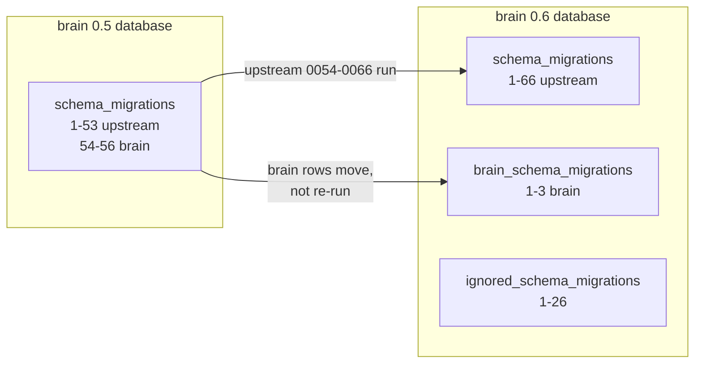

# Upgrading the brain to beads 1.3.4 (brain 0.6.0)

Brain 0.6.0 is brain on top of upstream beads `v1.3.4`. Its schema is newer than
the one every brain database holds today (brain 0.5.x on beads `1.1.0-rc.1`), so
the upgrade is two changes that must happen together: the databases move to the
1.3 schema, and every machine that runs a brain store moves to the 0.6.0 binary.

This page is the plan for doing that: what changes, every system involved, the
command that migrates the databases, the order of the steps on each machine, and
how to undo them. The migration was rehearsed end to end on a copy of the live
databases; the numbers below are from that rehearsal.

- [What the migration does](#what-the-migration-does)
- [Inventory](#inventory)
- [The command: `bd brain upgrade`](#the-command-bd-brain-upgrade)
- [Runbook](#runbook)
- [Rollback](#rollback)
- [Rehearsal](#rehearsal)
- [Hazards](#hazards)
- [Beads 1.3 primitives on brain stores](#beads-13-primitives-on-brain-stores)

## What the migration does

A brain 0.5 database records 56 migrations in `schema_migrations`: upstream's
0001-0053, then brain's own three (the ISA columns, the `isa_sections` table, the
slug index) as 0054-0056. Upstream 1.3 gives the numbers 0054-0066 to its own
migrations (claim leases, the comments keyset index, the events plane move, the
events journal, provenance, storage class). Read naively, a brain database looks
like it already ran upstream's 0054-0056.

The 0.6.0 binary keeps brain's migrations in a series of their own
(`brain_schema_migrations`). Migrating a brain database:

1. moves brain's three rows out of `schema_migrations` into
   `brain_schema_migrations` under their brain numbers (1-3), with the content
   hashes they were recorded with. Brain's migrations are not run again. If an
   upstream row sits above brain's rows the move refuses;
2. runs upstream's main series 0054-0066 and the ignored series 0012-0026 (the
   clone-local tables: leases, wisp tables, the events journal);
3. runs the re-keys upstream 1.3 carries: aux row ids (events, comments,
   snapshots) become content-derived, dependency ids are re-derived, and
   `is_blocked` is recomputed with a NULL-safe gate.

Brain's own tables (`brain_unified_*`, `brain_stores`, `brain_store_prefixes`,
`isa_sections`, the outbox) are not touched.



## Inventory

Every machine that runs a brain store or holds a brain database, as found on
2026-11-13 (read-only probes; raw output in the PR's evidence).

| Machine | Role | Brain binary (pin) | Dolt | Brain databases | Backups and remotes |
|---|---|---|---|---|---|
| **mini0** (100.84.99.99) | **Brain host** (`~/.config/brain/host.yaml`: `role: host` since 2026-10-27). Serves every store. | `~/.local/bin/bd` `1.1.0-rc.1+brain.0.5.1 (278ebfa25)`; pin `BD_WANT='1.1.0-rc.1 (278ebfa25)'`; 86 wrappers source `store-host.env` | 2.2.3, `sql-server` on 0.0.0.0:3307, remotesapi 3310, data `/Users/mini0/dolt-host/data` (launchd `com.brain.dolt-server`) | `brain_unified` (13 GB; 44,726 issues; 68 id prefixes; 75 `brain_stores` rows), `beads_global` (18 MB; 2,330 issues). Both at schema 56 with brain's rows at 54-56, ignored series at 11 | `brain_unified` registers backups `default` → `file:///Users/mini1/data/brain-unified-backup` and `backup_export` → `file:///Users/mini1/data/inbox/.beads/backup`: paths on mini1, so auto-backup on mini0 cannot write them (and `brain_app` may not run `DOLT_BACKUP`; every command logs "auto-backup failed … command denied"). `beads_global` has Dolt remotes `mini1` (`http://100.102.238.78:3310`, closed) and `mini3` (`http://100.86.9.58:3310`, open). |
| **mini1** (100.102.238.78) | Client of mini0 (`store-host.env` → 100.84.99.99). The previous host. | `~/.local/bin/bd` `1.1.0-rc.1+brain.0.5.1 (8a66e8ebe)`; pin `'1.1.0-rc.1 (8a66e8ebe)'`; 78 wrappers. **Homebrew `bd 1.3.2` (upstream) is first on PATH.** | 2.6.0; no brain server (one stray test server on 127.0.0.1:3308) | none served. Retired copies: `~/data/.beads/brain_unified`, `~/data/dolt-snapshot/staging/brain_unified`, `~/data/brain-lockdown-rollback-20261017/restore-drill/brain_unified` | `~/data/brain-unified-backup` (2.4 GB, 2026-10-17: the backup the live `default` registration names), `~/data/backups` (July consolidation archives) |
| **macbook** (100.74.138.74) | Client of mini0 (`store-host.env` → 100.84.99.99, user `brain_app`). The host before mini1. Runs the real-snapshot export for brain-playground. | `~/.local/bin/bd` and `/opt/homebrew/bin/bd` both `1.1.0-rc.1+brain.0.5.1 (0289514b4)`; no pin file; 74 wrappers source `store-host.env` | 1.83.1 (its servers belong to other projects: TinyKeyboard, beadhive walkthroughs) | none served. Retired copy: `~/data/.beads/brain_unified` (1.4 GB), `~/data/.beads/beads_global` | `~/data/brain-unified-backup` (1.4 GB, 2026-10-15) |
| **mini3** (100.86.9.58) | A separate, older per-store brain: 46 per-store databases (5.8 GB) in `~/data/.beads-local`, served on 127.0.0.1:3312 with remotesapi on 3310 (launchd `com.pai.dolt-server`), last written 2026-11-10. Its `brain` wrapper is a client-mode wrapper pointed at `mini1@100.102.238.78`, which is no longer the host. **Not in `fleet.yaml`.** | `~/.local/bin/bd` `1.1.0-rc.1+brain.0.5.1 (8a66e8ebe)`; `~/go/bin/bd` `1.2.2+brain (36433a3aa)` is first on PATH and the store wrappers `exec bd` | 2.2.3 | 46 per-store databases (`task`, `agent`, `beads_global`, …), each at schema 56 with brain's rows at 54-56 | serves `beads_global` to mini0's `mini3` remote |
| **lnx** (100.81.88.113) | Coder deployment (`brain-studio` template) and GitHub Actions runners (`trillium-coder`, `trillium-brain-playground`). | The workspace image ships upstream `bd 1.3.1`, embedded mode, seeded from a fake fixture on every start | none | none | Coder's own Postgres backups only |
| **brain-playground** | Disposable demo. Its real-Brain backend is upstream `bd 1.3.1` with its own Dolt on 3317 and fake data; it refuses port 3307 and `~/data`. Its "My real Brain" view reads one aggregate JSON that `npm run real-snapshot` writes on the MacBook through the store wrappers (`<store> --readonly --json list`). | — | — | none | — |

What this means for the upgrade:

- **Databases to migrate:** `brain_unified` and `beads_global` on mini0. mini3's
  46 databases are a separate brain; migrate them with the same command
  (`--port 3312`) only if that brain stays in use, otherwise retire it.
- **Binaries to replace:** mini0, mini1, macbook (and mini3 if its brain stays).
  lnx and brain-playground run upstream bd on their own fake data and are not
  affected.
- **Pins to update:** the `BD_WANT` line of `~/.local/bin/.bd-pin.sh` on mini0 and
  mini1 (owned by satellite-config). macbook has no pin.
- **Retired copies and old backups** on mini1 and macbook hold brain 0.5 data.
  They are not served; leave them, or delete them once 0.6.0 is settled.

## The command: `bd brain upgrade`

`bd brain upgrade` talks to the Dolt server directly and never opens the caller's
store (opening a store with a newer binary would itself be a migration attempt).
It needs a login that may run `DOLT_BACKUP` and DDL, which on mini0 is `root`, not
`brain_app`: `--user`, else `BEADS_DOLT_SERVER_USER`, else `root`; the password
from `BEADS_DOLT_PASSWORD`, else the `[host:port]` entry of
`~/.config/beads/credentials`. A `file://` backup is written by the server, so
run `backup`, `rehearse` and `rollback` on the server's own machine.

| Step | Writes to the live server? | What it does |
|---|---|---|
| `plan` | no | Per database: the cursors, brain's rows in `schema_migrations`, every migration left to run, the Dolt remotes, and whether a verified backup still matches. The dry run. |
| `backup --backup-dir D` | no (reads; the backup goes to `D`) | `DOLT_BACKUP('sync-url', file://D/<db>)` (no backup remote is registered), then opens the backup as a database on a Dolt server of its own and compares it with the database: `dolt_hashof_db()` (which covers the working set and the dolt-ignored tables), HEAD, and every table's row count, B-13 whole-row digest and `dolt_hashof_table`. Only an identical copy is marked verified. Records everything, including the database's remotes and backup registrations, in `D/brain-upgrade-manifest.json`. |
| `rehearse --backup-dir D` | no | Lays each backup out as a copy on a Dolt server of its own, migrates the copy, verifies it, rolls the copy back the offline way and proves the rollback. |
| `apply --backup-dir D` | **yes** | Refuses unless every selected database has a verified backup and is still exactly its state (`dolt_hashof_db()` equal). Refuses a database with Dolt remotes unless `--allow-remote-backed`. Then migrates (`schema.MigrateUpWithLock`) and verifies. |
| `verify --backup-dir D` | no | Every series at latest; every table and column the backup had is still there; per table, the row count and the whole-row digest over the columns the migration does not rewrite on purpose are unchanged. |
| `rollback --backup-dir D --yes --offline --data-dir DIR` | **yes** (server stopped) | Moves each database directory aside (kept as `<db>.migrated-<stamp>`) and lays the backup out in its place, keeping the repository config. Then start the server and run `rollback --check`. |
| `rollback --backup-dir D --yes` | **yes** | Online: `DOLT_BACKUP('restore', '--force', …)` on the running server, then puts back the remotes and backup registrations, then proves the backed-up state. Slow on a large database (see [Rehearsal](#rehearsal)). |
| `rollback --backup-dir D --check` | no | Compares each database with the state its backup holds. |

**Why the backup is opened rather than restored.** A `file://` Dolt backup is a
chunk store in the same layout as a database's `.dolt/noms`. Laid out under a
database directory (cloned copy-on-write on APFS, so it costs no space and
seconds), it opens as that database with its branches and working set.
`DOLT_BACKUP('restore')` would do the same and then check every chunk's
references across the whole history; on the 13 GB `brain_unified` that check
runs for hours with Dolt 2.2.3. The comparison after opening (database hash,
HEAD, every table) is what proves the backup, and it is the
same comparison B-13 used.

The whole-row digest is the one B-13 used: per table, `COUNT(*)` and
`BIT_XOR(CONV(SUBSTR(MD5(JSON_OBJECT(<every column>)), 1, 15), 16, 10))`, which
does not depend on row order. The columns 1.3 rewrites on purpose are left out of
the migration comparison and reported per table as `rewritten`: `id` of
`events`, `comments`, `issue_snapshots`, `compaction_snapshots`, `dependencies`,
`wisp_dependencies`, and `is_blocked` of `issues` and `wisps`. The migration
cursors are reported as `cursor` and checked by the "every series at latest"
test instead. Every step writes its JSON report under `D/reports/`.

## Runbook

Times are from the rehearsal on a copy of mini0's databases (13 GB), on mini0.

### Before the window (no downtime)

1. **Build 0.6.0 once** from the merged `main` with its release tag
   (`make brain-release` tags `brain/v0.6.0`; `make build`). Record what
   `bd --version` prints: `bd version 1.3.4 (<build>)`. The text after
   `bd version ` is the new pin value.
2. **Stage the binary on mini0** beside the live one, not over it, for example
   `~/.local/bin/bd-0.6.0`. The live wrappers keep using the old binary.
3. **Plan, on mini0** (reads only):
   ```sh
   BEADS_DOLT_PASSWORD=<root password> ~/.local/bin/bd-0.6.0 brain upgrade plan \
     --host 127.0.0.1 --port 3307 --user root
   ```
   Expect both databases to report brain's rows at 54, 55, 56, the main series
   53 → 66 (13 to run), the ignored series 11 → 26 (15 to run), and
   `beads_global`'s remotes.
4. **Check the disk on mini0.** The backup needs about the database's size
   (13 GB for `brain_unified`), and each verification or rehearsal restores
   another copy beside it while it runs (removed afterwards).
5. **Decide `beads_global`'s remotes.** `mini1`'s remote is unreachable; `mini3`
   serves a clone. A clone that keeps the old schema must not be merged or
   pushed back: migrate mini3's copy too, or remove the remote, before
   `apply --allow-remote-backed`.
6. **Prepare the pin change** in satellite-config: `BD_WANT='<new pin value>'`
   for mini0 and mini1, not yet converged.

### The window

Every writer is stopped from the backup until every client runs 0.6.0. The
old binary fails closed on the migrated schema (see [Rehearsal](#rehearsal)), so
a client missed in step 12 fails loudly instead of writing.

7. **Stop the writers.**
   - mini0: `launchctl bootout gui/$UID/com.brain.stores-sync`,
     `com.brain.host-render` (via `brain host`'s service list),
     `com.brain.pfw-reply-watch`, `com.brain.pfw-ready-watch`,
     `com.brain.searchable-mcp`; pause the agent fleet.
   - mini1: `com.brain.stores-sync`.
   - macbook: `com.trillium.brain-sync`, `com.brain.sync-store-docs`,
     `com.brain.pfw-reply-watch`, `com.beads-bridge.server`,
     `com.displayd.beads-activity-bridge`, `com.brain-dashboard`.
   - Leave `com.brain.dolt-server` running.
8. **Back up and verify, on mini0:**
   ```sh
   BEADS_DOLT_PASSWORD=<root password> ~/.local/bin/bd-0.6.0 brain upgrade backup \
     --host 127.0.0.1 --port 3307 --user root \
     --backup-dir /Users/mini0/data/brain-upgrade-0.6.0
   ```
   Both databases must print `VERIFIED`. If a writer was still running, the
   backup refuses ("moved … while the backup ran"): find it, stop it, run again.
9. **Rehearse (recommended):** the same flags with `rehearse`. It migrates a
   restored copy and must print `rehearsal PASS` for both databases.
10. **Apply:**
    ```sh
    BEADS_DOLT_PASSWORD=<root password> ~/.local/bin/bd-0.6.0 brain upgrade apply \
      --host 127.0.0.1 --port 3307 --user root \
      --backup-dir /Users/mini0/data/brain-upgrade-0.6.0 --allow-remote-backed
    ```
    It prints a `verify PASS` table per database. On a FAIL, go to
    [Rollback](#rollback).
11. **Converge the pin** (satellite-config) on mini0 and mini1. From here until
    step 12 finishes on a machine, its wrappers exit 78.
12. **Roll the binary out** with `brain rollout --apply --binary
    ~/.local/bin/bd-0.6.0` from mini0. It replaces the binary on each machine in
    `~/.config/brain/fleet.yaml` (mini0, mini1, macbook), keeps the old one as
    `bd.pre-<sha>`, and proves each machine runs the new version. On macbook,
    also replace `/opt/homebrew/bin/bd`, which is the same 0.5.1 build.
13. **Smoke test** on each machine: `brain stores doctor`, `task ready`,
    `brain list --limit 3`, and one write and its markdown render on a scratch
    store.
14. **Restart the writers** stopped in step 7, and resume the fleet.

### After the window

15. Re-register `brain_unified`'s backup destination on mini0
    (`bd backup init <mini0 path>`); the current one names a mini1 path. Give
    the account that runs auto-backup the right to call `DOLT_BACKUP`, or run it
    as root from launchd.
16. mini3: point its `~/.config/brain/remote.yaml` at mini0, and migrate or retire
    its per-store brain.
17. Keep the backup directory until 0.6.0 has run for a week.

## Rollback

**Before step 11** (the databases are migrated, nothing runs 0.6.0 yet), the
fast way, on mini0:

```sh
launchctl bootout gui/$UID/com.brain.dolt-server        # stop the server
~/.local/bin/bd-0.6.0 brain upgrade rollback --yes --offline \
  --data-dir /Users/mini0/dolt-host/data \
  --backup-dir /Users/mini0/data/brain-upgrade-0.6.0
launchctl bootstrap gui/$UID ~/Library/LaunchAgents/com.brain.dolt-server.plist
BEADS_DOLT_PASSWORD=<root password> ~/.local/bin/bd-0.6.0 brain upgrade rollback --check \
  --host 127.0.0.1 --port 3307 --user root \
  --backup-dir /Users/mini0/data/brain-upgrade-0.6.0
```

The migrated databases stay beside the restored ones as
`<db>.migrated-<stamp>`; delete them once the rollback is settled. `--check`
must report every database as the backed-up state. Then restart the writers on
the old binary; nothing else changed.

Without stopping the server, `rollback --yes` (no `--offline`) restores through
`DOLT_BACKUP('restore', '--force')`. It needs no restart, but on `brain_unified`
it runs for hours (see [Rehearsal](#rehearsal)), so it is the fallback.

**After step 11:** revert the pin, run `brain rollout rollback --apply` (it puts
each machine's `bd.pre-<sha>` back), then roll the databases back as above.
A rollback returns the databases to the backup: anything written after the
migration is lost. If writes happened, export them first (for example
`dolt diff` between the migration's last commit and HEAD) or fix forward
instead.

## Rehearsal

REHEARSAL-RESULTS

## Hazards

- **An upstream bd must never migrate a brain database.** Upstream 1.2 and 1.3
  read brain's rows at 54-56 as their own 0054-0056 and would run only 0057
  onward, leaving the lease columns, the leases table and the comments keyset
  index missing. Upstream refuses to auto-migrate a shared server, but `bd
  migrate --force` or `BD_ALLOW_REMOTE_MIGRATE=1` would do it. mini1 has
  Homebrew `bd 1.3.2` first on PATH; brain's wrappers are safe because the pin
  names `~/.local/bin/bd` explicitly, but an ad-hoc `bd` in a shell there is
  not. Only brain 0.6.0 (`bd brain upgrade`, or opening a store with consent)
  moves brain's rows first.
- **mini3's wrappers run `bd` from PATH**, which is `~/go/bin/bd`
  (`1.2.2+brain`, schema-compatible with 0.5 today). Pin them before mini3's
  databases move.
- **The backup must be taken with every writer stopped.** `apply` refuses a
  database whose `dolt_hashof_db()` moved since its backup; that refusal is the
  guarantee that a rollback loses nothing written before the migration.

## Beads 1.3 primitives on brain stores

PRIMITIVES-RESULTS
