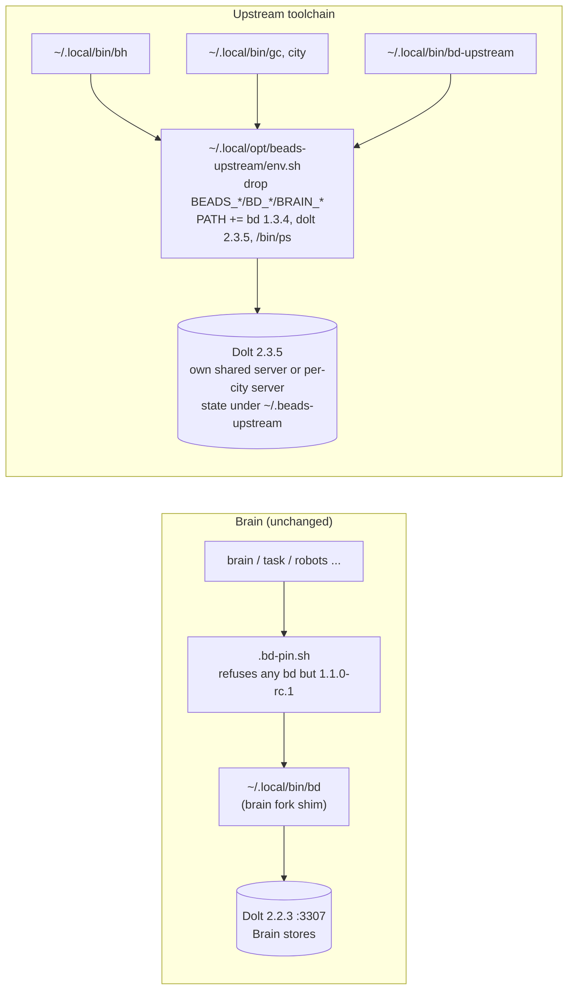

# Beadhive and Gas City on mini0

Beadhive (`bh`) and Gas City (`gc`) are built on **upstream** Beads 1.3.x.
Every Brain store runs the **brain fork** of `bd`, which is pinned at upstream
1.1.0-rc.1 (see [WHAT_BRAIN_ADDS.md](WHAT_BRAIN_ADDS.md)). This page records how
both tools were installed on mini0 next to Brain without changing `bd`, `brain`,
`task` or any store, how they were smoke-tested, and what to watch out for.

Installed 2026-11-13 (task `beads-tools-install`, Brain record `robots-pb7jb`).

## What is installed

| Tool | Version | Source | Lives in |
|---|---|---|---|
| upstream `bd` | 1.3.4 (`7ef2fd05e`) | `gastownhall/beads` release `beads_1.3.4_darwin_arm64.tar.gz` | `~/.local/opt/beads/1.3.4/bd` |
| `dolt` | 2.3.5 | `dolthub/dolt` release `dolt-darwin-arm64.tar.gz` | `~/.local/opt/dolt/2.3.5/bin/dolt` |
| `bh` (Beadhive) | 0.36.0 (tag `v0.36.0`, `071a89a`) | PyPI `beadhive[otel]==0.36.0` via `uv tool` | venv `~/.local/share/uv/tools/beadhive`, entry points `~/.local/opt/beadhive/bin/` |
| `git-workspace` | 1.10.1 | nixpkgs `e72e4f2` (the revision Beadhive's `flake.lock` pins) | `~/.local/opt/git-workspace/result` (nix out-link) |
| `gc` (Gas City) | 1.5.1 (tag `v1.5.1`, `4f698fe`) | `gastownhall/gascity` release `gascity_1.5.1_darwin_arm64.tar.gz` | `~/.local/opt/gascity/1.5.1/gc` |

Archive SHA-256s, checked against each release's published checksums:

```
b08a9c15bff80c42235f32946f94a6566a7d90944fe8afe45f3fd2f350596cdb  beads_1.3.4_darwin_arm64.tar.gz
ad1e3770accbb7e8a059069228ead22bdf6f2759131212451b44f518661b8e40  dolt-darwin-arm64.tar.gz (v2.3.5)
26c56827bf1606f19720bd26b52f910700ff2d7fb7e1801da12ed7679d2e02a2  gascity_1.5.1_darwin_arm64.tar.gz
```

Why these versions:

- **bd 1.3.4** is the latest stable upstream release (1.4.0-rc.1 is a
  prerelease). Beadhive 0.36.0's own toolchain pins bd 1.3.0, and its hive
  write guard is proved on `bd >=1.3.0,<1.4` (`BH_FENCE_CANARY_BD_RANGE`), so
  1.3.4 is in range. Gas City 1.5.1 tests against bd 1.0.4 through 1.3.2
  (`deps.env`) and links the beads library at v1.3.2. `gc doctor` accepts 1.3.4.
- **dolt 2.3.5** is the version Beadhive pins and proves its guard on
  (`>=2.3.5,<2.4`). Gas City needs 2.1.0 or newer. The Homebrew `dolt` (2.2.3)
  that serves the Brain stores is untouched.
- **Beadhive** has no GitHub releases, only tags. `v0.36.0` is the latest tag and
  matches PyPI.
- **Gas City** publishes darwin binaries, so nothing was built from source.

## How it coexists with Brain



- `~/.local/bin/bd` is still the brain fork shim. The Brain wrappers call it by
  absolute path through `.bd-pin.sh`, which refuses any version except
  `1.1.0-rc.1 (278ebfa25)`, so nothing on PATH can replace it.
- The upstream tools never go on the global PATH. `bh`, `gc`, `city` and
  `bd-upstream` are small wrappers in `~/.local/bin` that source one env file
  and then exec the real binary. The env file puts the upstream toolchain first
  on PATH **for that process only**, so the `bd` and `dolt` that Beadhive and
  Gas City shell out to are 1.3.4 and 2.3.5.
- The env file unsets every `BEADS_*`, `BD_*` and `BRAIN_*` variable before
  running. A shell that inherited `BEADS_DIR`, `BEADS_DOLT_SERVER_PORT=3307` or
  similar from a Brain wrapper or an agent session therefore can't point an
  upstream tool at a Brain store. To pass those variables through on purpose,
  set `BEADS_UPSTREAM_KEEP_ENV=1`.
- Upstream bd's shared Dolt server keeps its state in
  `~/.beads-upstream/shared-server` (`BEADS_SHARED_SERVER_DIR`), not in
  `~/.beads/shared-server`, which the brain fork would also use. It listens on
  bd's default shared port, 127.0.0.1:3308. Brain's server is on :3307.
- The wrappers hard-code `/Users/mini0/.local/opt` rather than `$HOME`, so they
  keep working under a throwaway `HOME`. That's how the smoke tests below were
  isolated.

`~/.local/opt/beads-upstream/env.sh`, without its header comment:

```sh
_ssd="${BEADS_SHARED_SERVER_DIR:-$HOME/.beads-upstream/shared-server}"
if [ "${BEADS_UPSTREAM_KEEP_ENV:-}" != 1 ]; then
  for _v in $(env | sed -nE 's/^((BEADS|BD|BRAIN)_[A-Za-z0-9_]*)=.*/\1/p'); do
    unset "$_v"
  done
  unset _v
fi
export BEADS_SHARED_SERVER_DIR="$_ssd"
unset _ssd
PATH="/Users/mini0/.local/opt/beads-upstream/bin:$PATH"
export PATH
```

`~/.local/opt/beads-upstream/bin/` holds only symlinks: `bd` →
`../../beads/1.3.4/bd`, `dolt` → `../../dolt/2.3.5/bin/dolt`, `git-workspace`
→ `../../git-workspace/result/bin/git-workspace`, and `ps` → `/bin/ps` (see
[Known issues](#known-issues)).

Each wrapper is a comment and two commands. `~/.local/bin/gc`:

```sh
#!/bin/sh
# Upstream beads toolchain wrapper (see /Users/mini0/.local/opt/beads-upstream/env.sh).
. /Users/mini0/.local/opt/beads-upstream/env.sh
exec /Users/mini0/.local/opt/gascity/1.5.1/gc "$@"
```

`bh` execs `/Users/mini0/.local/opt/beadhive/bin/bh`, and `bd-upstream` execs
`/Users/mini0/.local/opt/beads-upstream/bin/bd`. `~/.local/bin/city` is a
symlink to `gc`. It replaces the old `city` and `gc` symlinks, which both
pointed at `/Users/trilliumsmith/go/bin/gc`, a path that doesn't exist on mini0.

Coexistence check after the install:

```
$ command -v bd brain task bh gc city bd-upstream
~/.local/bin/bd
~/.local/bin/brain
~/.local/bin/task
~/.local/bin/bh
alias gc='git commit'
~/.local/bin/city
~/.local/bin/bd-upstream
$ bd --version            # brain fork, unchanged
bd version 1.1.0-rc.1 (278ebfa25)
$ brain --version
bd version 1.1.0-rc.1 (278ebfa25)
$ task --version
bd version 1.1.0-rc.1 (278ebfa25)
$ bd-upstream --version
bd version 1.3.4 (7ef2fd05e)
$ bh --version
0.36.0
$ city version
1.5.1
$ BEADS_DIR=$HOME/data/brain/.beads BD_NAME=brain sh -c ". ~/.local/opt/beads-upstream/env.sh; env | grep -E ^(BEADS|BD|BRAIN)_; command -v bd dolt ps"
BEADS_SHARED_SERVER_DIR=~/.beads-upstream/shared-server
~/.local/opt/beads-upstream/bin/bd
~/.local/opt/beads-upstream/bin/dolt
~/.local/opt/beads-upstream/bin/ps
```

## Install commands

Run these as `mini0` to reproduce or repair the install. Each download is
checked against the release's published checksum.

```sh
D=$(mktemp -d); O=/Users/mini0/.local/opt

# upstream bd 1.3.4
gh release download v1.3.4 --repo gastownhall/beads \
  -p beads_1.3.4_darwin_arm64.tar.gz -p checksums.txt -D "$D/beads"
(cd "$D/beads" && shasum -a 256 -c checksums.txt --ignore-missing && tar xzf beads_1.3.4_darwin_arm64.tar.gz)
mkdir -p "$O/beads/1.3.4" && install -m 755 "$D/beads/bd" "$O/beads/1.3.4/bd"

# dolt 2.3.5 (compare with the asset digest GitHub publishes)
gh release download v2.3.5 --repo dolthub/dolt -p dolt-darwin-arm64.tar.gz -D "$D/dolt"
gh api repos/dolthub/dolt/releases/tags/v2.3.5 \
  --jq '.assets[]|select(.name=="dolt-darwin-arm64.tar.gz").digest'
shasum -a 256 "$D/dolt/dolt-darwin-arm64.tar.gz"
tar xzf "$D/dolt/dolt-darwin-arm64.tar.gz" -C "$D/dolt"
mkdir -p "$O/dolt/2.3.5/bin" && install -m 755 "$D/dolt/dolt-darwin-arm64/bin/dolt" "$O/dolt/2.3.5/bin/dolt"

# Gas City 1.5.1
gh release download v1.5.1 --repo gastownhall/gascity \
  -p gascity_1.5.1_darwin_arm64.tar.gz -p gascity_1.5.1_checksums.txt -D "$D/gc"
(cd "$D/gc" && shasum -a 256 -c gascity_1.5.1_checksums.txt --ignore-missing && tar xzf gascity_1.5.1_darwin_arm64.tar.gz)
mkdir -p "$O/gascity/1.5.1" && install -m 755 "$D/gc/gc" "$O/gascity/1.5.1/gc"

# git-workspace 1.10.1 from the nixpkgs revision Beadhive pins (no nix profile change)
mkdir -p "$O/git-workspace"
nix build --out-link "$O/git-workspace/result" \
  'github:NixOS/nixpkgs/e72e4f299401a3689d4b3d5fc6496b11db7064eb#git-workspace'

# Beadhive 0.36.0; entry points go to $O/beadhive/bin, not ~/.local/bin
mkdir -p "$O/beadhive/bin"
UV_TOOL_BIN_DIR="$O/beadhive/bin" uv tool install --force 'beadhive[otel]==0.36.0'

# toolchain dir that the wrappers put first on PATH
mkdir -p "$O/beads-upstream/bin"
ln -sfn ../../beads/1.3.4/bd                         "$O/beads-upstream/bin/bd"
ln -sfn ../../dolt/2.3.5/bin/dolt                    "$O/beads-upstream/bin/dolt"
ln -sfn ../../git-workspace/result/bin/git-workspace "$O/beads-upstream/bin/git-workspace"
ln -sfn /bin/ps                                      "$O/beads-upstream/bin/ps"
# then write $O/beads-upstream/env.sh and the ~/.local/bin wrappers shown above,
# and: ln -s gc ~/.local/bin/city
```

Beadhive's README recommends `nix profile add github:beadhive/beadhive/latest#default`,
which installs bh's whole toolchain into the nix profile. **Don't use that route
on mini0.** It puts a nix `bd`, `dolt`, `gh`, `git` and `procps` `ps` into
`~/.nix-profile/bin`, which would change what other tools resolve, and its `ps`
is the cause of robots-cq12o (below).

To upgrade, install the new version into a new versioned directory, repoint the
symlink or wrapper, and re-run the smoke tests. For Beadhive:
`UV_TOOL_BIN_DIR=$O/beadhive/bin uv tool install --force 'beadhive[otel]==<ver>'`,
then confirm with `bh --version`. Beadhive warns that the exit code alone
doesn't prove the upgrade happened.

## Smoke tests

Each tool ran under a throwaway `HOME` in a temporary directory, with git and
Dolt identities set to `Smoke Test <smoke@example.invalid>`. Its config, hive,
city and Dolt data lived only there, and each run used its own Dolt server on
dolt 2.3.5. Neither tool was pointed at a Brain store, the `brain_unified`
database or the :3307 server. Both scratch servers were stopped afterwards
(`bd-upstream dolt stop`). `~/.gc`, `~/.beadhive` and `~/.beads-upstream`
still don't exist in the real home, `~/.beads/shared-server/dolt` is still
empty, and no launchd job was installed.

### Beadhive: `bh setup check`, `bh hq init`, `bh plan check`

```sh
export HOME=$(mktemp -d)        # plus a .gitconfig with user.name/email
bh setup check
bh config init
git init -q --bare -b main /path/to/scratch/beadhive-hq.git
bh config set hq.remote /path/to/scratch/beadhive-hq.git   # local remote; nothing leaves the machine
bh hq init --auto
bh plan check hello-molecule.yaml
```

`bh setup check`:

```
Checking post-ws dependencies…
  ✓ git-workspace  (git-workspace 1.10.1)
  ✓ gh  (gh version 2.96.0 (nixpkgs))
  ✓ bd  (bd version 1.3.4 (7ef2fd05e))
  ✓ dolt  (dolt version 2.3.5)
  ✓ procps  (ps: illegal option -- -)
✓ setup complete — cache updated.
```

`bh hq init --auto` (exit 0, trimmed):

```
  ✓ Shared Dolt server started
  ✓ Global database beads_global available
  ✓ Shared server mode enabled
✓ bd initialized successfully!
  Backend: dolt
  Mode: server
  Server: root@127.0.0.1:3308
  Database: hq
  Issue prefix: hq
✓ registered factory/hq as prefix 'hq' (kind=hq)
✓ Factory HQ store initialized at $HOME/.beadhive/hq (prefix 'hq', kind=hq)
hq init: wiring remote file:///…/beadhive-hq.git
  pre-push backup:
    ✓ jsonl-export …/issues.jsonl — 0 lines (bd reports 0 issues)
    ✓ dolt-native-backup …/dolt-native (412,081B) — 412,081B
    ✓ remote-dolt-data-ref — no pre-existing refs/dolt/data on the remote — nothing to back up
  ✓ wrote fleet.yaml
  ✓ wrote workspace.toml
  ✓ wrote allowed_signers
  ✓ wrote hosts/README.md
✓ HQ remote wired (file:///…/beadhive-hq.git) — pushed main + refs/dolt/data
```

The robots-cq12o port bug didn't appear: bd started its shared server on :3308
and then recognised it. See [Known issues](#known-issues) for why.

`hello-molecule.yaml` is a two-issue molecule: `script`, then `test`, which
depends on it, each with acceptance criteria:

```yaml
epic:
  title: 'Smoke test: print hello from a tiny script'
  priority: 3
  complexity: SIMPLE
  description: |
    Throwaway molecule used to smoke-test `bh plan check` on mini0.
issues:
- handle: script
  title: 'Add hello.sh that prints hello'
  type: task
  priority: 3
  complexity: SIMPLE
  description: |
    Write hello.sh that prints the word hello and exits 0.
  acceptance: |
    - Running sh hello.sh prints exactly "hello" and exits 0.
- handle: test
  title: 'Add a test that runs hello.sh'
  type: task
  priority: 3
  complexity: SIMPLE
  deps: [script]
  description: |
    Add test.sh that runs hello.sh and checks its output.
  acceptance: |
    - sh test.sh exits 0 when hello.sh prints "hello" and non-zero otherwise.
```

```
$ bh plan check hello-molecule.yaml
  complexity epic: SIMPLE score=0.106 source=beadhive/bifrost-compatible-local@1.0.0+bifrost.c1b84fdc5a85 provenance=explicit
  complexity script: SIMPLE score=0.007 source=beadhive/bifrost-compatible-local@1.0.0+bifrost.c1b84fdc5a85 provenance=explicit
  complexity test: SIMPLE score=0.107 source=beadhive/bifrost-compatible-local@1.0.0+bifrost.c1b84fdc5a85 provenance=explicit
✓ valid
exit=0
```

A copy with `test`'s acceptance removed and its dependency renamed to `missing`
fails as it should:

```
$ bh plan check bad-molecule.yaml
  - issue 'test': missing 'acceptance' (required for accuracy)
  - issue 'test': dep 'missing' references an unknown handle
exit=1
```

### Gas City: a throwaway city running an exec order and a formula order

```sh
export HOME=$(mktemp -d)        # plus a .gitconfig with user.name/email
dolt config --global --add user.name  "Smoke Test"           # gc's managed bd store requires it
dolt config --global --add user.email smoke@example.invalid
gc init --template minimal --default-provider claude --skip-provider-readiness \
  --no-start --preserve-existing "$HOME/smoke-city"
cd "$HOME/smoke-city"
```

Two manual-trigger orders. `orders/hello.toml` is an exec order: a shell
script, no agent.

```toml
[order]
description = "Smoke test: write a hello line, no agent"
trigger = "manual"
exec = "scripts/hello.sh"
```

`orders/hello-formula.toml` dispatches a two-step v2 formula,
`formulas/hello.toml`, with steps `write`, then `check`, which needs `write`:

```toml
[order]
description = "Smoke test: dispatch the hello formula to the mayor pool"
trigger = "manual"
formula = "hello"
pool = "mayor"
```

```
$ gc order run hello
Order "hello" executed (exec)
$ cat hello.out
hello from gas city order at 2026-11-13T05:19:40Z

$ gc formula show hello
Formula: hello
Description: Smoke test: two-step hello formula

Steps (3):
  ├── hello.write: Write hello.sh
  ├── hello.check: Check hello.sh [needs: hello.write]
  └── hello.workflow-finalize: Finalize workflow [needs: hello.check]
$ gc order run hello-formula
Order "hello-formula" executed: wisp sc-41t → gc.routed_to=mayor
$ gc order history hello-formula
ORDER                BEAD            EXECUTED
hello-formula        sc-wisp-npz     2026-11-13T05:20:07Z
hello-formula        sc-41t          2026-11-13T05:20:03Z

$ bd-upstream list --all
○ sc-41t P2 hello
○ sc-5z3 P2 Write hello.sh
○ sc-e7i P2 Finalize workflow
○ sc-phj P2 Check hello.sh
Total: 4 issues (4 open, 0 in progress)
$ bd-upstream ready
○ sc-41t P2 hello
○ sc-5z3 P2 Write hello.sh
Ready: 2 issues with no active blockers
```

The formula's step beads are in the city's own bd 1.3.4 store
(`smoke-city/.beads`, `dolt_mode: proxied-server`), and only the first step
is ready. `gc doctor` reports `bd version 1.3.4` and `dolt 2.3.5` as OK. The
city was never started (see below), so no agent picked up the work.

## Known issues

1. **robots-cq12o (bd says its own Dolt server is "a non-dolt process") is an
   upstream bd bug, still present in 1.3.4. On mini0 the wrappers avoid it.**
   bd finds its Dolt server by running `ps -axo pid=,state=,command=` from PATH
   and splitting the output by position (`internal/doltserver/doltserver_unix.go:48-88`).
   When `ps` prints an empty state column, the binary path is read as the
   state, the server isn't recognised, and `reclaimPort` refuses the port.
   macOS's setuid `/bin/ps` fills the column: on mini0 it was blank for 1 of
   696 rows. The nix `procps-1003.1` `ps` that Beadhive's managed toolchain
   installs left it blank for 662 of 692 rows, including every `dolt
   sql-server`. That is the walkthrough's failure. The wrappers put `ps` →
   `/bin/ps` first on PATH, so the bug can't trigger even if a nix `ps` is
   added later. Upstream: gastownhall/beads#7121 (open, p1), with fix PRs
   gastownhall/beads#7130, gastownhall/beads#8311 and gastownhall/beads#8354
   still open. The machine-side fix is
   tracked in `task-ub8wis`.
2. **`gc` is a zsh alias for `git commit`** in interactive shells on mini0. Type
   `city` (or `command gc`) at the prompt. Scripts and non-interactive shells
   get the real `~/.local/bin/gc`.
3. **`gc start` installs a launchd service, and the minimal template starts a
   Claude agent.** `gc start` registers the city with the machine-wide
   supervisor and writes and loads a launchd job. It refuses to run under an
   overridden `HOME`; Gas City says to use `GC_HOME` for isolated runs. The
   `minimal` template declares a `mayor` named session with `mode = "always"`,
   so starting the city launches a Claude session. The smoke test stopped
   before `gc start`, because `gc order run` works without the supervisor. Run
   `gc start` deliberately, with real credentials, when a city should actually
   work.
4. **`gc init` fails without a Dolt identity**, with "startup is blocked by Dolt
   author identity", and leaves the city without a bead store. Run `dolt config
   --global --add user.name/user.email`, then `gc init --preserve-existing …` to
   finish. mini0's real home already has a Dolt identity.
5. **Upstream bd sends anonymous usage metrics by default.** Its first run says
   so. They were turned off in the scratch homes. For real use,
   `bd-upstream metrics off` disables them for the current `HOME`. The brain
   fork is not affected.
6. **A manual exec order leaves no tracking bead.** `gc order history hello`
   prints "No order history" even though the script ran. Formula orders do
   record history.
7. **Version skew to watch.** Gas City 1.5.1 is tested against bd up to 1.3.2
   and links the beads v1.3.2 library, while the bd on its PATH is 1.3.4.
   Beadhive pins bd 1.3.0. Both are inside their declared ranges today. If one
   misbehaves, install the version it pins into its own `~/.local/opt/beads/<ver>`
   and give that tool its own toolchain directory. The sniss6 report described
   Gas City `main` (`dba2033`), which links beads v1.3.4; the 1.5.1 release
   does not.
8. **`bd-upstream version` warns about "multiple 'bd' binaries found in PATH".**
   This is expected (the brain fork is second on the wrapper's PATH), and only
   the `version` command prints it.
9. **Port 3308.** Upstream bd's shared server and the brain fork's shared-server
   default both use 127.0.0.1:3308. The Brain wrappers pin :3307, so nothing
   collides today. A plain `bd` (brain fork) run in shared-server mode without
   a wrapper could still start a fork server there.
